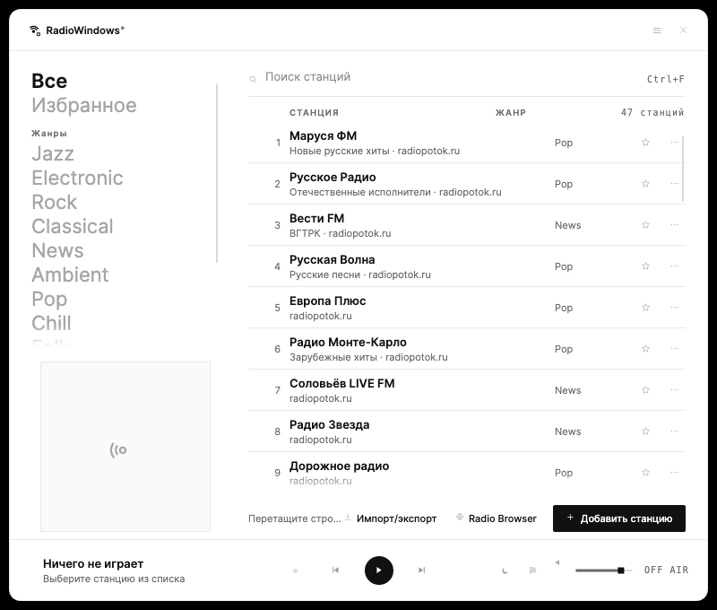
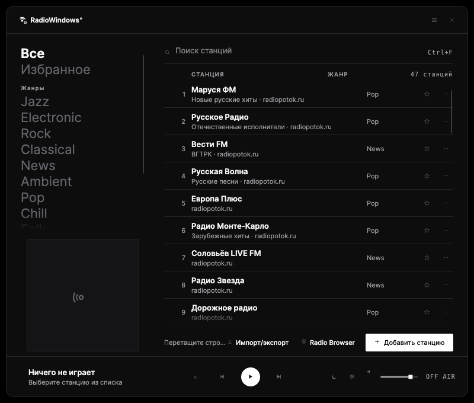
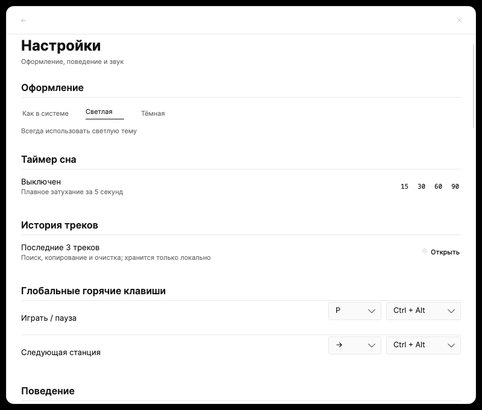
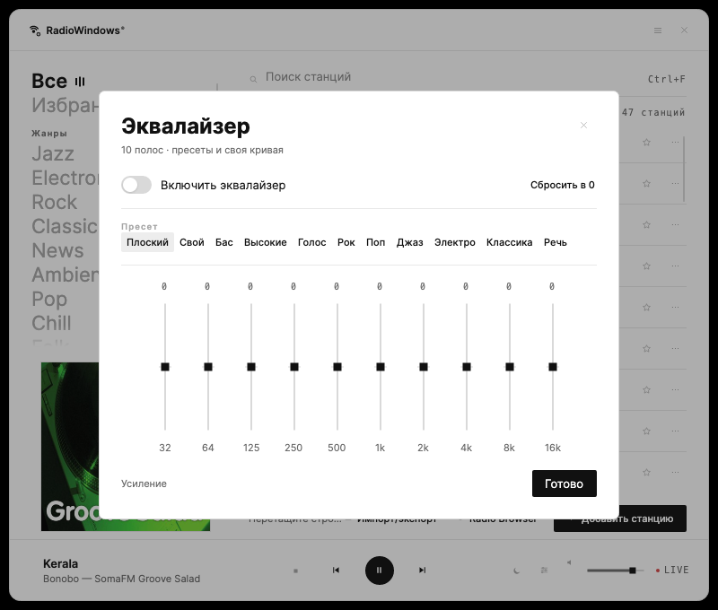
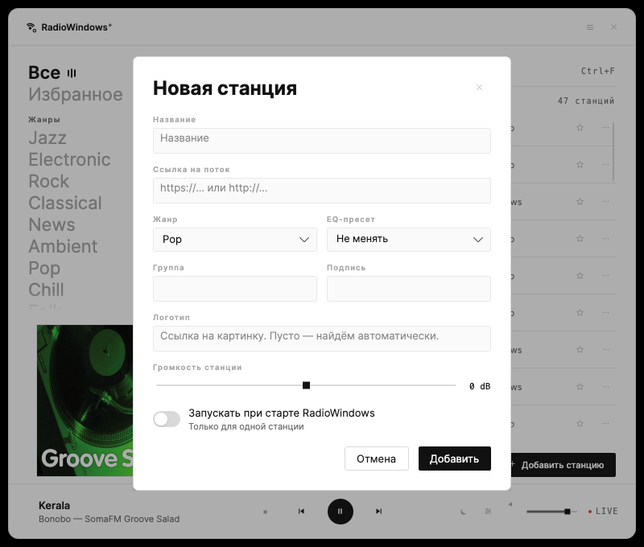
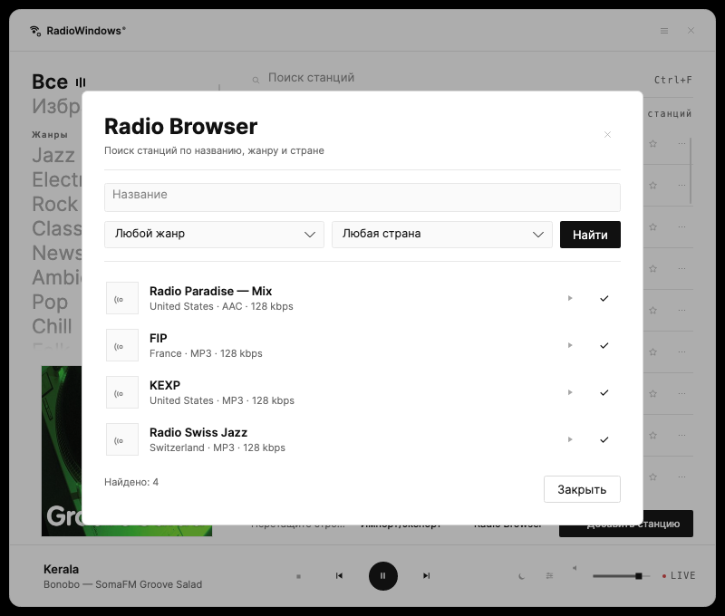
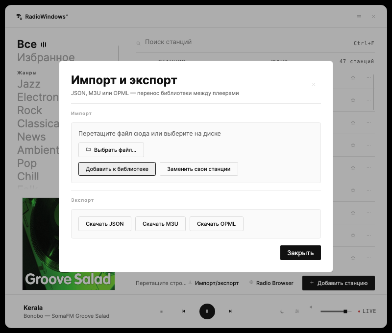
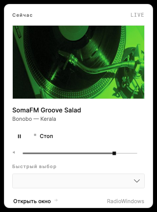
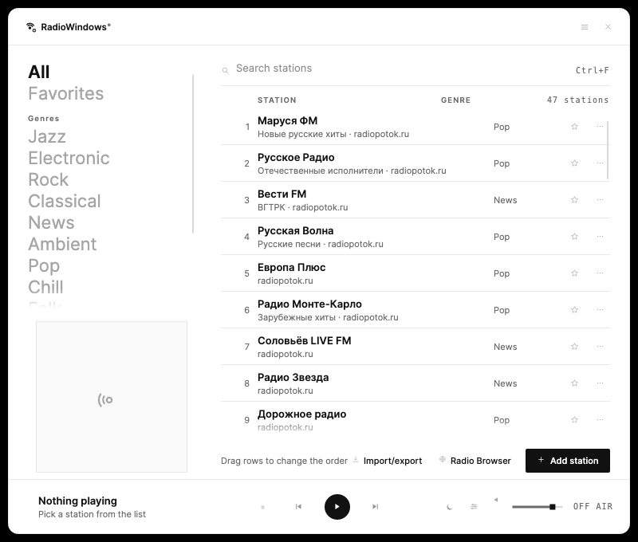

# RadioWindows

Плеер интернет-радио для Windows, который живёт в системном трее: без окна на панели задач,
с эфиром, который продолжается после закрытия окна. Написан на **.NET 10 / C# + Avalonia**
поверх нативного аудиодвижка **BASS 2.4** (MP3, AAC/AAC+, Opus, FLAC, HLS, ICY) с 10-полосным эквалайзером **BASS_FX**.

Интерфейс — светлый редакционный минимализм: бумажный фон, одна краска (чернила), крупная
типографика и таблица станций. Это Windows-порт
[RadioMac](https://github.com/fso13/RadioApple): та же библиотека из 47 станций, та же
монохромная система, те же сценарии — с горячими клавишами Windows, реестром автозапуска и
установщиком.

[](https://github.com/fso13/RadioWindows/actions/workflows/ci.yml)
[](https://github.com/fso13/RadioWindows/actions/workflows/release.yml)
[](https://github.com/fso13/RadioWindows/actions/workflows/security.yml)

## Скачать

Текущая версия — **1.1.0** (аудиодвижок BASS). Все сборки — self-contained:
устанавливать .NET отдельно не нужно. Требуется Windows 10 1809+ или Windows 11, x64.

| Что | Где | Как использовать |
| --- | --- | --- |
| **Установщик** (рекомендуется) | [RadioWindows-Setup.exe](https://github.com/fso13/RadioWindows/releases/latest/download/RadioWindows-Setup.exe) | запустить → «Установить» → приложение откроется |
| **Портативная сборка** | [RadioWindows-Portable.zip](https://github.com/fso13/RadioWindows/releases/latest/download/RadioWindows-Portable.zip) | распаковать в любую папку и запустить `RadioWindows.exe` |
| **Контрольные суммы** | [SHA256SUMS.txt](https://github.com/fso13/RadioWindows/releases/latest/download/SHA256SUMS.txt) | `Get-FileHash -Algorithm SHA256 <файл>` |
| **История версий** | [CHANGELOG.md](CHANGELOG.md) · [все релизы](https://github.com/fso13/RadioWindows/releases) | что изменилось и когда |

Установщик ставит приложение в профиль пользователя
(`%LOCALAPPDATA%\Programs\RadioWindows`) и не требует прав администратора. Ярлык добавляется
в меню «Пуск», по желанию — на рабочий стол. Приложение проверяет обновления через GitHub
Releases: Настройки → Обновления → «Проверить».

Сборка не подписана сертификатом EV, поэтому SmartScreen может показать предупреждение:
«Подробнее» → «Выполнить в любом случае». Если хочется проверить целостность — сравните
SHA-256 с `SHA256SUMS.txt` из релиза.

## Возможности

- **Трей без панели задач**: левый клик — мини-плеер, правый — меню
  (играть/пауза, стоп, таймер сна, история, настройки, выход). Тултип показывает станцию и трек.
- **Окно 780×660 без рамки**: своя шапка, перетаскивание, Esc или × скрывают окно,
  эфир продолжается.
- **Навигация по жанрам**: крупные слова слева, активный жанр с эквалайзер-индикатором,
  «Все» и «Избранное», группы станций. Обложка текущей станции/трека — рядом.
- **Таблица станций**: номер, название и подпись, жанр, избранное, меню ⋮ и контекстное меню;
  поиск (Ctrl+F) с подчёркиванием, счётчик в шапке, кнопка «Добавить станцию».
- **Группы и порядок**: необязательная группа в редакторе станции, фильтр групп в навигации
  и перетаскивание строк в режиме «Все», чтобы изменить порядок.
- **Воспроизведение**: MP3, AAC/AAC+, Opus, FLAC и HLS через BASS; пауза/продолжить, стоп,
  предыдущая/следующая станция в текущей выборке, громкость, LIVE/OFF AIR.
- **Автопереподключение**: при обрыве статус «Переподключение…», backoff 1/2/5/10 с,
  4 попытки, кнопка «Повторить» и восстановление без выбора станции заново.
- **Метаданные трека**: ICY-теги отдельным side-channel, Icecast `status-json.xsl`,
  API SomaFM и Radio Paradise, обложка из iTunes; обложка и трек — в мини-плеере и тултипе.
- **Логотипы станций**: Radio Browser → сайт из ICY → favicon домена, кэш в памяти и на диске.
- **Диагностика потока**: кодек, битрейт, частота, каналы, буфер и сервер в настройках;
  кнопка «Скопировать диагностику» для issue.
- **Нативный эквалайзер**: 10 полос BASS_FX (32 Гц – 16 кГц), пресеты, своя кривая,
  сохранение; меняется без перезапуска потока.
- **Таймер сна**: 15/30/60/90 минут, плавное затухание за 5 секунд, индикатор
  в окне и трее, отмена.
- **Будильник-радио**: дни недели, выбор станции, плавное нарастание громкости
  и локальное уведомление.
- **История треков**: последние 100 треков со станцией и временем, поиск,
  копирование и очистка; хранится только локально.
- **Глобальные горячие клавиши**: настраиваемые play/pause и следующая станция
  через `RegisterHotKey`, работают при скрытом окне; проверка конфликтов с системой.
- **Автозапуск**: раздел `Run` в реестре текущего пользователя, включается одной кнопкой.
- **Radio Browser**: поиск станций по названию, жанру и стране, превью потока,
  добавление в библиотеку и защита от дублей по URL/external ID.
- **Импорт и экспорт**: JSON, M3U и OPML, drag-and-drop, режимы «Добавить/Заменить»
  с сохранением избранного.
- **Настройки станции**: смещение громкости в dB, свой EQ-пресет и автозапуск
  при старте RadioWindows; сохраняются в библиотеке.
- **Last.fm**: opt-in OAuth, now-playing и scrobble после 4 минут. API-ключи
  встраиваются при сборке из GitHub Secrets, сессия — в защищённом хранилище Windows;
  отключение одной кнопкой.
- **Диагностика**: opt-in локальный журнал, обнаружение аварийных завершений,
  просмотр, копирование и очистка; без отправки данных.
- **Мини-плеер**: поповер из трея с обложкой, названием, play/pause, громкостью
  и быстрым выбором станции — без основного окна.
- **Тема**: системная / светлая / тёмная — инверсия одной и той же системы.
- **Локализация**: русский и английский интерфейс (язык берётся из системы, переопределяется
  переменной `RADIOWINDOWS_LANG=ru|en`), доступные имена для экранного диктора (Narrator),
  уважение системной темы.
- **Автообновление**: проверка GitHub Releases и переход к установщику новой версии.
- **Автоматизация**: ссылки `radiowindows://play/<id>`, `radiowindows://pause`,
  `radiowindows://open`, `radiowindows://settings` (схема регистрируется установщиком);
  старый `radiomac://` работает как алиас.

### Горячие клавиши

| Клавиши | Действие |
| --- | --- |
| `Esc` | убрать фокус из поиска, иначе скрыть окно |
| `Space` | пауза / продолжить |
| `↑` `↓` | двигать выделение |
| `Return` | играть выделенную станцию |
| `1`…`9` | сразу включить станцию из списка |
| `Ctrl+F` | фокус в поиск |
| `Ctrl+N` | новая станция |
| `Ctrl+Alt+P` | глобально: пауза / продолжить |
| `Ctrl+Alt+→` | глобально: следующая станция |

## Установка и данные

1. Запустите `RadioWindows-Setup.exe` (или распакуйте портативную сборку).
2. Приложение появится в трее. Установщик сразу открывает окно; обычный запуск стартует
   свёрнутым в трей.
3. Все настройки, станции и история лежат в `%APPDATA%\RadioWindows\`:
   - `settings.json` — станции, громкость, тема, эквалайзер, будильник, горячие клавиши;
   - `logs\radio-debug.log` — локальный журнал (если включён);
   - `cache\images\` — кэш обложек.
4. Удаление — «Параметры приложения» → RadioWindows → «Удалить» или
   `%LOCALAPPDATA%\Programs\RadioWindows\unins000.exe`. Данные в `%APPDATA%` остаются,
   чтобы после переустановки вернуться к своей библиотеке; удалите папку вручную, если не нужна.

Автозапуск добавляет в `HKCU\Software\Microsoft\Windows\CurrentVersion\Run` значение
`RadioWindows = "<путь>\RadioWindows.exe" --background`. Отключается тумблером в настройках.

## Скриншоты

| Главный экран | Тёмная тема |
| --- | --- |
|  |  |

| Настройки | Эквалайзер | Новая станция |
| --- | --- | --- |
|  |  |  |

| Radio Browser | Импорт и экспорт | Мини-плеер |
| --- | --- | --- |
|  |  |  |

Английский интерфейс включается переменной `RADIOWINDOWS_LANG=en`:



Скриншоты рендерятся без ручных кликов — `scripts/screenshots.ps1` (headless Avalonia + Skia),
поэтому их можно обновлять в CI после изменений интерфейса.

## Сборка из исходников

Требуется [.NET SDK 10](https://dotnet.microsoft.com/) (проект собирается и на macOS/Linux —
пригодится для UI-тестов; аудио и трей проверяются на Windows).

```powershell
dotnet build RadioWindows.sln
dotnet test tests/RadioWindows.Core.Tests
dotnet run --project src/RadioWindows -- --show
```

Релизная сборка и установщик:

```powershell
scripts/publish.ps1 -Version 1.0.0     # publish\ + dist\RadioWindows-Setup.exe + SHA256SUMS.txt
scripts/publish.ps1 -SkipInstaller     # только портативный архив (без Inno Setup)
```

`publish.ps1` делает self-contained `win-x64` публикацию, кладёт рядом нативные библиотеки
BASS (они уже лежат в `src/RadioWindows/Native/`), собирает установщик Inno Setup 6 и считает SHA-256. Без установленного Inno Setup
остаётся только `dist\RadioWindows-Portable.zip`.

### Ключи Last.fm

Скробблинг работает, только если при сборке встроены ключи API (или заданы переменные
окружения при запуске — удобно для разработки):

```powershell
# встроить в сборку
scripts/publish.ps1 -Version 1.0.0 `
    -LastFmApiKey "0123456789abcdef..." `
    -LastFmApiSecret "fedcba9876543210..."

# или подставить при запуске из исходников
$env:RADIO_LASTFM_API_KEY="..."
$env:RADIO_LASTFM_API_SECRET="..."
dotnet run --project src/RadioWindows -- --show
```

В GitHub Actions ключи берутся из секретов `LASTFM_API_KEY` и `LASTFM_API_SECRET`
(workflow `release.yml`). Без ключей раздел Last.fm честно пишет, что они не заданы,
и остальные функции работают как обычно.

## Релиз

1. Добавьте секцию в `CHANGELOG.md`: `## [1.0.0] — 2026-10-22`.
2. Поставьте и отправьте тег:

   ```powershell
   git tag v1.0.0
   git push origin v1.0.0
   ```

3. Workflow `release.yml` соберёт приложение, прогонит тесты, соберёт установщик и
   портативный архив, возьмёт заметки из changelog и создаст GitHub Release. Ссылки на
   `RadioWindows-Setup.exe`, `RadioWindows-Portable.zip` и `SHA256SUMS.txt` в разделе
   «Скачать» ведут на `/releases/latest/download/...`, поэтому README не нужно править
   после каждого релиза.
4. Обновите строку версии в этом README, если релиз меняет канал или требования.

Отдельный статичный сайт не нужен: страница проекта — этот README. Скриншоты лежат в
`docs/screenshots/`, история версий — в `CHANGELOG.md`.

## Структура

```
RadioWindows.sln                  решение
src/RadioWindows.Core/            логика без UI: модели, каталог, сервисы, локализация
  Models/                         RadioStation, NowPlaying + парсер, EQ-пресеты, StreamInfo, AlarmSettings
  Data/                           встроенный каталог (47 станций) и справка
  Services/                       плеер, библиотека, эквалайзер, будильник, Last.fm, импорт/экспорт,
                                  Radio Browser, метаданные, логотипы, диагностика, обновления
  Localization/                   Loc + Strings-ru/en.json
src/RadioWindows/                 Avalonia-приложение
  Views/                          Shell, MainPage, Settings, модальные окна, мини-плеер
  ViewModels/                     состояние страниц и таблицы станций
  Controls/                       иконки, бренд-глиф, обложки, фейдеры, эквалайзер-бары, тумблер
  Styles/                         палитра, токены, стили контролов
  Services/                       композиция сервисов, трей, глобальные клавиши, автозапуск, тосты
  Assets/                         иконка приложения и трея
  Native/                         bass*.dll / libbass*.dylib, add-on'ы и их лицензии
tests/RadioWindows.Core.Tests/    модульные тесты логики
tools/ScreenshotTool/             headless-рендер скриншотов
tools/AudioProbe/                 smoke-тест BASS: поток, ICY-метаданные, эквалайзер
installer/RadioWindows.iss        Inno Setup 6
scripts/                          publish, dev, screenshots, release notes
.github/workflows/                CI, release, CodeQL, security
docs/screenshots/                 PNG для README
CHANGELOG.md                      история версий
SECURITY.md                       политика безопасности
ROADMAP.md                        планы
```

## Архитектура

`AppServices` — композиционный корень: `Preferences` (JSON в `%APPDATA%`), `AppSettings`,
`ThemeService`, `StationLibrary`, `EqualizerService`, `RadioPlayerService`, `SleepTimerService`,
`AlarmService`, `TrackHistoryService`, `LastFmService`, `DiagnosticsService`, `UpdateService`.
`ShellViewModel` держит текущую страницу, модальный слой и тосты; `MainPageViewModel` —
фильтры, поиск, выделение и транспорт. `RadioPlayerService` — единственный владелец
`IAudioEngine`: состояния, ICY-метаданные и «сейчас играет» приходят в UI через
`IUiDispatcher` (main-поток Avalonia).

`IAudioEngine` реализуют `BassAudioEngine` (BASS: MP3/AAC/Opus/FLAC/HLS, ICY-метаданные,
10 полос BASS_FX) и `NullAudioEngine` (тесты и среда без нативных библиотек).
Эквалайзер применяется к живому потоку, станция не перезапускается.

## Тесты

`tests/RadioWindows.Core.Tests` — 179 проверок без сети, `tests/RadioWindows.UiTests` — 9
headless-тестов Avalonia (рендер, поиск, фильтры, воспроизведение, все модальные окна).

- целостность каталога (47 станций, уникальные id, HTTPS-ссылки);
- нормализация жанров, JSON-ключи станции, миграция `flutter.*`;
- парсер `StreamTitle='…'`, «исполнитель — трек», отсев мусора;
- 10 полос эквалайзера, клампинг, подписи частот, персистентность;
- библиотека: добавление, дубликаты, избранное, порядок, импорт, восстановление каталога;
- будильник: расписание и следующий запуск; горячие клавиши: разбор и отображение;
- ICY/Icecast/SomaFM/Radio Paradise/iTunes-парсеры на фикстурах;
- JSON/M3U/OPML импорт-экспорт и Radio Browser на фикстурах;
- Last.fm: подпись MD5, разбор сессии; история, диагностика, обновления.

`tools/ScreenshotTool` рендерит светлые и тёмные состояния в PNG — это и проверка вёрстки,
и материал для README. UI-тесты складывают PNG в `tests/RadioWindows.UiTests/bin/.../screenshots`
и запускаются в CI на Windows.

## Отличия от macOS-версии

- **Аудиодвижок**: BASS 2.4 вместо AVFoundation; HLS, AAC/AAC+, Opus, FLAC и ICY,
  10-полосный эквалайзер BASS_FX. Кодеки — нативные add-on'ы BASS.
- **Трей**: `TrayIcon` Avalonia вместо `NSStatusItem`; левый клик открывает мини-плеер,
  правый — нативное меню. Окно так же скрывается, а не закрывается.
- **Горячие клавиши**: `RegisterHotKey` (Ctrl+Alt+P, Ctrl+Alt+→) вместо Carbon.
- **Автозапуск**: раздел Run в реестре вместо `SMAppService`.
- **Медиацентр**: нет `MPNowPlayingInfoCenter`/виджета macOS 14+ — состояние показывают
  мини-плеер и тултип трея. Медиа-клавиши клавиатуры не перехватываются (см. ROADMAP).
- **Обновления**: собственная проверка GitHub Releases вместо Sparkle/EdDSA.
- **Локализация**: ru/en так же, но строки лежат в JSON-словарях, а не в String Catalog.
- **Установщик**: Inno Setup вместо DMG/PKG; данные — в `%APPDATA%`, а не в песочнице.
- **Лицензия аудио**: BASS free for non-commercial, BASS_AAC — GPLv2; в macOS-версии
  этих ограничений не было (системные AVFoundation).

## Ограничения

- Только Windows x64; сборка на macOS/Linux нужна для тестов, аудио там не проверяется.
- Установщик не подписан EV-сертификатом — SmartScreen может предупредить.
- BASS и add-on'ы — внешние нативные библиотеки (см. `src/RadioWindows/Native/licenses`).
  BASS бесплатен для некоммерческого использования; для коммерческого нужна лицензия
  [un4seen](https://www.un4seen.com/). `bass_aac` распространяется по GPLv2 (FAAD2).
- HLS воспроизводится через `basshls`; если сервер отдаёт несовместимый TLS/плейлист,
  станция покажет ошибку и предложит «Повторить».
- Нет синхронизации между компьютерами и облачных аккаунтов: все данные локальные.
- Будильник работает, пока приложение запущено; после сна Windows возможна задержка
  до нескольких минут.

## Сторонние компоненты

[Avalonia](https://avaloniaui.net/) (MIT) · [BASS](https://www.un4seen.com/) (free for
non-commercial use) · BASS_FX, BASSHLS, BASSOPUS, BASSFLAC · BASS_AAC (GPLv2 / FAAD2) ·
[Inter](https://rsms.me/inter/) (OFL) · xUnit (Apache 2.0). Тексты лицензий — в
`src/RadioWindows/Native/licenses/` и в установленной папке `licenses/`.
Иконки и бренд-глиф нарисованы для проекта; визуальный референс — Office Radio app
(Marko Kolić / PROTOTYP), реализация оригинальная.
